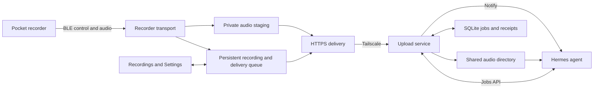

# MVP design proposal

The implemented app uses **Sync** for pending transfers, **Delivered** for receipt-confirmed recordings, and **Settings** for recorder and destination setup. The backend can transcribe delivered audio before handing the transcript to an agent. The wireframes below preserve the original design proposal. See the [setup guide](../setup.md) for the current workflow.

## Experience

Open Pocket should feel like a small transfer utility. Opening it reconnects to the configured recorder, discovers recordings, and starts the queue. Each recording shows where it is going and whether its audio is still on the phone. Playback and troubleshooting stay close to the recording.

### Recordings screen

```text
Open Pocket                         Settings
Pocket · Connected                  Reconnect
Example Agent · Reachable

2 recordings waiting · 1 transferring

Today, 10:42                         04:12
Downloading · 63%                   [progress]
Destination: Example Agent

Today, 09:15                         12:08
Delivered · local copy kept for 6 more days
Play                  Details / More

Yesterday, 16:20                     02:34
Upload failed · Will retry
Destination: Example Agent                Retry

Transfer history
```

The connection area distinguishes recorder connectivity from agent reachability. An empty list explains whether setup is missing, the recorder is disconnected, or no recordings were found. Progress uses bytes when a size is known; discovery uses an activity indicator.

A recording's details sheet shows timestamp, duration, size, destination, local availability, and the last transfer result. Actions are playback, retry, confirmed deletion from Pocket, and removal of a delivered local copy. Deleting from Pocket warns when delivery is not confirmed. Playback is available only while a local copy exists; removing that copy leaves the history entry visible.

History opens in a sheet on this screen. It contains timestamps, transfer stages, and actionable errors; it excludes raw protocol traffic, credentials, and audio.

### Settings screen

```text
Settings

Pocket
Selected recorder                   Connect / Choose
Binding setup                       Connection test

Agent
Name                                Example Agent
Service URL                         [HTTPS tailnet address]
Upload credential                   [protected token]
Server identity                     Validated HTTPS certificate
                                    Test connection
                                    Save destination

Storage
Local audio                         [used space]
Automatic cleanup                   7 days after delivery
                                    Clean delivered copies
```

Initial setup guides the user through selecting the nearby recorder, supplying or establishing its binding, and configuring the agent. Existing binding behavior needs bench validation before defining the final setup copy. Bluetooth permission denial offers a retry or a route to Android Settings.

Saving an agent requires a clear validation result. A destination change shows how many existing recordings are assigned to the previous destination. Proposed MVP behavior: pause those uploads until the user chooses to finish the old queue or explicitly move selected undelivered recordings to the new destination. The default is to keep the original assignment. No setting change silently redirects files. Moving an upload whose outcome is uncertain requires checking its previous destination first.

## Runtime structure



Use a native Android application with a local transactional database, application-private audio files, and Android Keystore protection for secrets. Kotlin is the proposed language; UI toolkit and library versions will be selected after design review and compatibility verification.

Separate recorder transport, persistent queue, HTTPS transport, and UI responsibilities. A single foreground coordinator serializes recorder operations. Download and upload are independent: losing Pocket must not block delivery of recordings already on the phone. MVP starts with BLE download; Wi-Fi acceleration is an optional later slice if measured BLE throughput is inadequate.

Run synchronization while the app is visible. Leaving it stops new work and cancels transfers safely; reopening reconciles interrupted operations. Do not hold a background service or schedule closed-app transfers. Authentication errors and invalid server certificates require user action; temporary network failures use bounded retry backoff while the app is open.

## Durable state and recovery

| State | Meaning | Recovery behavior |
| --- | --- | --- |
| Pending | Discovered, awaiting download or setup | Recheck recorder availability |
| Downloading | Writing an incomplete private staging file | Restart safely; resume only if offsets are verified |
| Downloaded | Complete local audio accepted | Queue delivery to its assigned destination |
| Uploading | Sending staged remote files | Reconcile remote completion before retrying |
| Delivered | Agent inbox durably accepted matching content | Retain local audio for seven days |
| Failed | An operation needs retry or intervention | Preserve last completed stage and copies |

Store recorder identity, recording identifier, raw device timestamp, interpreted timestamp/time zone, duration, byte count, content hash, local availability, destination assignment, attempt state, and delivery receipt. A delivery is keyed by recording identity and destination identity. Metadata remains after local cleanup so a rediscovery cannot cause a duplicate upload.

Persist a download as complete only after its expected byte count and available integrity checks pass and its staging file is finalized. Reconcile database/file inconsistencies on startup. BLE repeat handling must be tested against actual packet boundaries; do not discard equal packets merely because their contents match.

## Upload service and Hermes contract

Use a small HTTPS REST service reached over Tailscale. Android configures its service URL and a scoped upload token, protected locally with Android Keystore. Validate the HTTPS certificate using platform trust and never offer a bypass. The service authenticates every request and limits upload sizes and disk use. Server paths are configured on the service; clients cannot submit arbitrary filesystem paths.

The service receives audio and metadata, validates byte count and SHA-256, stages the file privately, and atomically finalizes it in a directory shared with the agent. It owns a small SQLite database of accepted recordings, durable delivery receipts, processing jobs, and pending notifications. Receipt and job creation occur in one database transaction after the audio is durable. Startup reconciliation handles a crash between file finalization and the transaction. Android considers delivery confirmed only when it can retrieve a matching accepted receipt.

The agent accesses the job list and statuses through the service API, using its own credential. It reads audio from the shared directory and claims work through the API, which serializes database writes. A lease prevents concurrent claims and allows recovery if the agent stops. Completion or failure updates must match the active claim. Job states are `queued`, `processing`, `completed`, and `failed`; processing failure never invalidates a successful delivery receipt or triggers another audio upload.

The service notifies the agent after acceptance using a configured adapter. Notification is a hint to query the jobs API, not a second work queue. Pending notifications persist and retry; periodic agent polling recovers from missed notifications. The exact Hermes notification hook remains to be verified. Receipt retention and a unique recording/destination identity prevent duplicate delivery even if the agent later moves the audio.

See the [proposed service contract](upload-service.md) for endpoints, security boundaries, and recovery behavior. The service is a small companion component of the MVP; Hermes retains all transcription and interpretation logic. Deployment to Example Agent requires a separately reviewed host-specific plan.

## Storage and privacy

Keep audio until confirmed delivery. Automatic cleanup removes local audio seven days after that confirmation, on the next foreground session. Pause cleanup for a file being played. Manual cleanup applies only to delivered local copies and requests confirmation. Pocket deletion is always an explicit, confirmed action; automatic local cleanup never sends recorder delete commands.

Disable Android backup of credentials and audio. Never commit secrets or pulled recordings. Use synthetic metadata and generated test media. Keep bounded diagnostics in private storage and redact endpoint credentials and protocol secrets. Validate recorder filenames, advertised sizes, remote metadata, and local paths before using them.

## Review decisions and verification gaps

- Confirm HTTPS service setup and scoped token provisioning for Example Agent.
- Review the upload, receipt, and jobs API contract and verify the Hermes notification adapter.
- Confirm the proposed destination-change flow: pause old uploads, then explicitly finish or reassign them.
- Verify recorder binding, listing response variants, transfer boundaries, safe recording-state handling, and the deletion command on the nearby device.
- Verify foreground lifecycle, BLE performance, and permissions on Pixel 7 Pro. No live test has passed yet.
